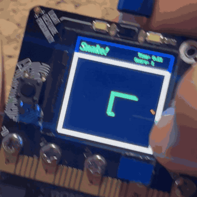

# ClueSnake

Classic Snake for the [Adafruit CLUE](https://www.adafruit.com/product/4500) (nRF52840), built with PlatformIO and the Arduino framework.



## Gameplay

- The snake moves on its own. **Button A** turns it left and **Button B** turns it right, relative to its current heading.
- Eat the red treats to score a point and grow longer.
- Hitting the wall or your own tail ends the game. Reach a score of **10** to win.
- The scoreboard at the top shows elapsed time and score. Press either button on the game-over screen to play again.

## Hardware

- Adafruit CLUE (nRF52840) with its 240×240 ST7789 TFT
- Built-in buttons: A (pin 5) and B (pin 11)
- Onboard QSPI flash, which holds the splash screen image

> The demo shows the CLUE mounted in an Adafruit Bonsai Buckaroo. The game doesn't actually use that add-on board, so it's not needed.

## Building and flashing

Requires [PlatformIO](https://platformio.org/) (CLI or the VS Code extension).

```bash
pio run -t upload
```

Library dependencies are pinned in [`platformio.ini`](platformio.ini) and installed automatically:

| Library | Version |
| --- | --- |
| Adafruit GFX Library | 1.11.3 |
| Adafruit ST7735 and ST7789 Library | 1.9.3 |
| arduino-timer | 2.3.1 |
| Adafruit SPIFlash | 3.11.0 |
| Adafruit ImageReader Library | 2.8.1 |
| SdFat - Adafruit Fork | 1.5.1 |
| Adafruit EPD | 4.5.0 |

### Splash screen

On boot the game draws `/images/snake.bmp` from the CLUE's QSPI flash filesystem and waits for a button press. The image must be an uncompressed 24-bit BMP.

A small .NET tool for pushing images to the CLUE's flash is coming later.

If the image is missing or the flash filesystem can't be mounted (for example, unformatted flash), the splash screen is skipped and the game starts right away.

## How it works

- **Game loop:** `arduino-timer` fires a callback every 1 ms that sets an update flag every 50 ms, giving about 20 frames per second. `loop()` runs one `GameBoard::Update()` per frame inside a single `startWrite()`/`endWrite()` SPI transaction.
- **Input:** The buttons are read with falling-edge interrupts that queue one pending rotation. The game applies it on the next frame, with a 3-frame debounce.
- **Rendering:** The screen is never fully cleared during play. Each frame erases the tail segments the snake just left, redraws the snake, and refreshes only the right half of the scoreboard.
- **Collision:** The snake is a list of small rectangular `Segment`s. Collisions with treats, walls and its own body are checked as rectangle and point intersections. New treats spawn at random positions that don't overlap the snake.

### Source layout

| File | Purpose |
| --- | --- |
| `main.cpp` | Setup, frame timer and main loop |
| `GameBoard` | Game state, input handling, collisions, treat spawning |
| `Snake` / `Segment` | Snake body, movement, growth and drawing |
| `Treat` | Food placement, drawing and hit detection |
| `ScoreBoard` | Title bar with timer and score |
| `GameOverScreen` | Win and lose panel |
| `ImageLoader` | Draws BMPs from QSPI flash (splash screen) |
| `ClueDisplay` | ST7789 display initialization |
| `Point`, `Common.h`, `Colors.h` | Geometry, direction and rotation enums, RGB565 colors |
